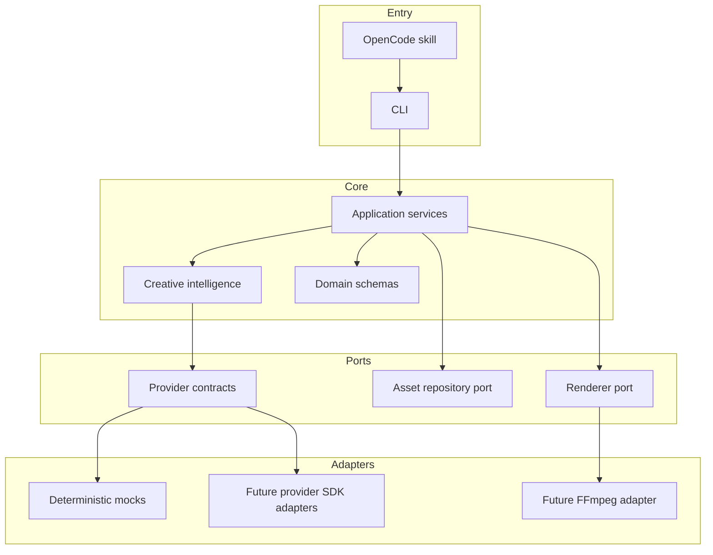
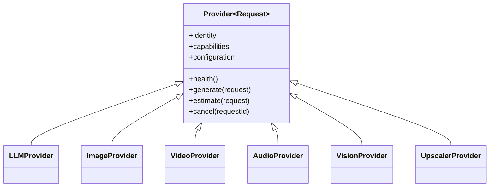

# Architecture

## System Overview

XOILIE is a local-first TypeScript application organized around stable domain data and replaceable
side-effect boundaries. Phase 0 deliberately implements contracts and deterministic test doubles,
not production generation or rendering.



The dependency rule points inward: adapters depend on contracts, while domain and application code
do not import vendor SDKs. This prevents provider details from spreading through creative logic.

## Directory Responsibilities

| Path                      | Responsibility                                                      |
| ------------------------- | ------------------------------------------------------------------- |
| `src/cli`                 | Argument parsing and human-facing command output                    |
| `src/application`         | Use cases that coordinate domain objects and ports                  |
| `src/creative`            | Provider-neutral creative workflow contracts; future planning logic |
| `src/domain`              | Zod schemas and inferred TypeScript domain types                    |
| `src/providers`           | Provider contracts, normalized errors, and implementations          |
| `src/assets`              | Asset persistence/versioning port                                   |
| `src/rendering`           | Timeline rendering port; no FFmpeg implementation yet               |
| `src/config`              | Environment parsing and safe runtime configuration                  |
| `src/core`                | Small cross-cutting primitives such as redacting logs               |
| `src/project`             | Manifest parsing, validation, and serialization                     |
| `.opencode/skills/xoilie` | Conversational OpenCode skill definition                            |
| `tests/unit`              | Pure component and contract tests                                   |
| `tests/integration`       | Filesystem and CLI boundary tests                                   |

Directories for prompt compilation, routing, timeline operations, and concrete renderers will be
added when code exists for them. Empty enterprise-style layers are intentionally absent.

## Domain Model

`ProjectSchema` is the aggregate root and uses `schemaVersion: 1`. It references:

- `CreativeBrief` and `StyleBible` for creative intent and global continuity
- `Character`, `CreativeObject`, `Environment`, and `Reference` as canonical identity records
- `Shot` and `StoryboardFrame` for visual planning
- `Asset`, `Generation`, and `GenerationMetadata` for provenance and versioning
- `Timeline`, `AudioTrack`, and `Export` for assembly and delivery
- `ProviderDefinition` for project-level provider selection without credentials

Schemas are runtime contracts, while their inferred TypeScript types are compile-time contracts.
Manifest migrations will be explicit functions keyed by schema version; readers must not silently
guess or rewrite older data.

## Provider Abstraction

`Provider<Request>` defines identity, capabilities, configuration metadata, health, generation,
estimation, and cancellation. Specialized request contracts define LLM, image, video, audio, vision,
and upscaling operations without adopting a vendor's parameter names.



Provider-specific prompt translation belongs inside the adapter or a future prompt-adapter module,
not in shot planning. External errors must be normalized to `ProviderError`, with retryability made
explicit.

## Creative Pipeline

The intended pipeline is:

```text
idea -> brief -> style -> story -> shots -> storyboard -> asset plan
     -> prompt compilation -> generation -> continuity checks -> timeline
     -> audio -> quality control -> export
```

Every stage will consume and produce validated structured data. Phase 0 defines stage names and core
data; it does not yet execute this pipeline.

## Asset Lifecycle

The planned lifecycle is `planned -> generating -> ready | failed -> archived`. Every generated
asset receives immutable generation metadata and a monotonically increasing version. New results
must never overwrite a previous successful version. `AssetRepository` is the persistence port so a
filesystem implementation can later be replaced without changing orchestration.

## Generation Lifecycle

Generation records move through `queued -> running -> succeeded | failed | cancelled`. The record
holds input and output asset IDs and normalized error fields. Future orchestration will checkpoint
after each successful shot, making retries resumable rather than restarting the project.

## Rendering Lifecycle

A renderer accepts a validated timeline and export specification, performs preflight checks, renders
to a temporary destination, validates output, and atomically promotes the result. FFmpeg is the
intended first adapter, but it is not a Phase 0 runtime dependency.

## Configuration Flow

```text
process environment / untracked .env
              -> validated AppConfig
              -> application provider selection
project.json  -> validated Project settings and provider IDs
```

Secrets stay in environment variables or a future secure credential store. Project manifests may
record only the name of an environment variable, never its value. Logs recursively redact common
secret-shaped keys.

## Error Handling

- Invalid manifests and configuration fail at the boundary with Zod validation details.
- Provider failures are mapped to stable `ProviderError` codes and carry an explicit retryable flag.
- Cancellation uses `AbortSignal` at request boundaries.
- Future orchestration will persist completed units before retry or fallback.
- CLI stubs report absence honestly rather than manufacturing successful output.

## Extension Points

- Provider: implement a category contract under `src/providers/<category>/<provider>`.
- Workflow: implement `CreativeWorkflow` under `src/creative/workflows`.
- Prompt compiler: add canonical compilation under `src/prompts` and vendor adaptation near the
  provider adapter.
- Renderer: implement `Renderer` under `src/rendering/<renderer>`.
- Asset store: implement `AssetRepository` under `src/assets`.
- CLI command: add a thin command in `src/cli`; business logic stays in `src/application`.

New extension directories should be created only with their first implementation and tests.
