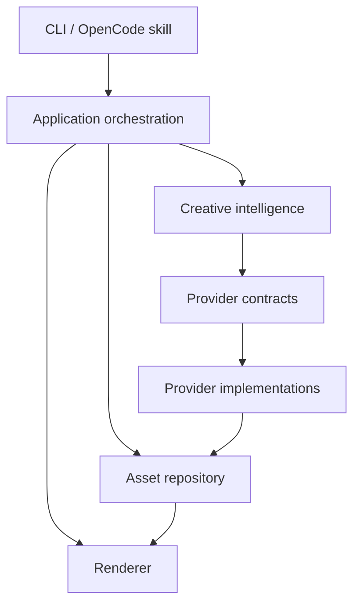

# XOILIE

XOILIE is an open-source, free-first AI creative production engine designed to orchestrate image,
video, audio, storytelling, cinematography, and editing workflows.

The project is currently at **Phase 0**: its repository conventions, typed domain model, provider
contracts, deterministic mock providers, project manifest, CLI surface, OpenCode skill, tests, and
CI are implemented. Creative planning, real provider integrations, generation, and rendering are
roadmap work. Commands never claim that unavailable work succeeded.

## Why XOILIE

Creative tooling should not require one vendor, one model, or a paid service merely to develop and
test a workflow. XOILIE is being designed as a local-first developer tool whose creative state is
structured, editable, portable, and reproducible. It is an open-source/free-first alternative for
building creative pipelines, not a claim of feature parity with any commercial product.

## Foundation Features

- Runtime-validated TypeScript schemas for projects, briefs, style systems, shots, assets,
  generations, timelines, audio, and exports
- Provider-neutral LLM, image, video, audio, vision, and upscaler interfaces
- Deterministic mock providers that require no API keys and identify every result as mock output
- A schema-versioned `project.json` manifest and safe project initializer
- A CLI with honest placeholders for the planned product surface
- A discoverable OpenCode skill at `.opencode/skills/xoilie/SKILL.md`
- Strict formatting, linting, type checking, unit tests, integration tests, and GitHub Actions CI
- Secret-safe configuration: manifests store environment-variable names, never credential values

## Architecture



Application and creative code depend on contracts. A provider adapter may depend on an external SDK,
but no vendor SDK belongs in the domain or orchestration layers. See
[`ARCHITECTURE.md`](ARCHITECTURE.md).

## Requirements

- Node.js 22.12 or newer; Node.js 22 LTS is the contributor baseline
- npm 10 or newer
- No API key, model download, GPU, or FFmpeg installation is required for Phase 0

## Quick Start

```bash
npm install
npm run build
npm link
creative init "My Film"
creative providers
creative generate --bypass
```

The last command intentionally reports `Not implemented yet.` while confirming that bypass mode was
detected. It does not create imaginary media.

For repository-local use without `npm link`:

```bash
npm run build
npm run creative -- init "My Film"
```

## CLI Status

| Command                | Phase 0 behavior                                             |
| ---------------------- | ------------------------------------------------------------ |
| `creative init <name>` | Creates a validated project manifest and project directories |
| `creative providers`   | Lists deterministic mock providers and their capabilities    |
| `creative plan [idea]` | Reports `Not implemented yet.` and exits nonzero             |
| `creative storyboard`  | Reports `Not implemented yet.` and exits nonzero             |
| `creative generate`    | Detects `--bypass`, reports unavailable, and exits nonzero   |
| `creative render`      | Reports `Not implemented yet.` and exits nonzero             |
| `creative edit`        | Reports `Not implemented yet.` and exits nonzero             |
| `creative assets`      | Reports `Not implemented yet.` and exits nonzero             |
| `creative models`      | Reports `Not implemented yet.` and exits nonzero             |
| `creative inspect`     | Reports `Not implemented yet.` and exits nonzero             |
| `creative export`      | Reports `Not implemented yet.` and exits nonzero             |
| `creative doctor`      | Reports `Not implemented yet.` and exits nonzero             |

## Provider Matrix

| Provider        | Category | Access | Phase 0 output                          |
| --------------- | -------- | ------ | --------------------------------------- |
| `mock-llm`      | LLM      | Local  | Deterministic text reference            |
| `mock-image`    | Image    | Local  | Deterministic `mock://` image reference |
| `mock-video`    | Video    | Local  | Deterministic `mock://` video reference |
| `mock-audio`    | Audio    | Local  | Deterministic `mock://` audio reference |
| `mock-vision`   | Vision   | Local  | Deterministic analysis reference        |
| `mock-upscaler` | Upscaler | Local  | Deterministic `mock://` image reference |

Mock providers do not create playable media in Phase 0. They provide stable contract fixtures for
development and CI. No real provider is bundled or implied.

## Development

```bash
npm run format:check
npm run lint
npm run typecheck
npm run test:unit
npm run test:integration
npm run build
```

Read [`DEVELOPMENT.md`](DEVELOPMENT.md) for setup and [`CONTRIBUTING.md`](CONTRIBUTING.md) for the
extension map.

## Roadmap

This is an engineering sequence. Versions indicate intended boundaries, not release dates.

- **v0.1 - Repository + Creative Planning**
- **v0.2 - Image Generation**
- **v0.3 - Video Generation**
- **v0.4 - Consistency Engine**
- **v0.5 - Timeline + Rendering**
- **v0.6 - Audio**
- **v0.7 - Local Models**
- **v0.8 - Web Workspace**
- **v0.9 - Intelligent Provider Routing**
- **v1.0 - Full Creative Production Engine**

## License and Model Terms

XOILIE source code is licensed under the permissive [MIT License](LICENSE). Third-party models,
provider APIs, SDKs, fonts, and media retain their own licenses and terms. Users and provider
contributors are responsible for checking commercial-use limits and generated-content restrictions.
XOILIE does not bundle third-party model weights.

## Security

Never place credentials in `project.json`, issue reports, logs, or source files. See
[`SECURITY.md`](SECURITY.md) for private vulnerability reporting and provider security rules.
